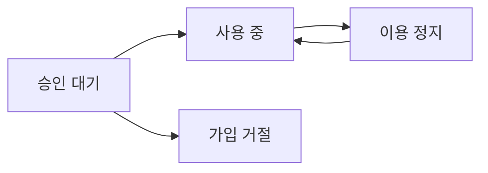

{/* 확인 필요: 외부 가입을 받는지와 미리 보기 단계 표현 */}
MeterEngine은 지금 미리 보기 단계라 테스트 환경에서 연동을 검증하는 용도로 씁니다. 자세한 내용은 [소개](/index)를 보세요.

{/* 확인 필요: 외부 가입을 받는지와 미리 보기 단계 표현 */}
https://meterengine.com/signup 에서 누구나 가입을 신청할 수 있고, MeterEngine 팀이 신청을 확인해 승인하면 로그인해 쓸 수 있습니다. 가입 신청은 콘솔의 가입 화면에서 합니다.

## 가입부터 첫 로그인까지

<Steps>
<Step title="가입 신청서를 쓴다">
https://meterengine.com/signup 을 열면 '도입사 가입 신청' 화면이 나옵니다. 아래 입력란을 채우고 필수 동의에 모두 체크한 뒤 '가입 신청'을 누릅니다.

| 입력란 | 제한 |
| --- | --- |
| 도입사 이름 | 필수, 255자 이내 |
| 담당자 이름 | 필수, 255자 이내 |
| 이메일 | 필수, 254자 이내. 로그인할 때 쓰는 값입니다. 대소문자를 가리지 않고 한 계정으로 보며 소문자로 바꿔 저장합니다 |
| 비밀번호 | 8자 이상 72자 이하. 한글은 1자를 3자로 계산합니다 |
| 필수 동의 | '이용 안내'와 '개인정보 처리 안내'에 모두 체크합니다 |

신청한 사람은 그 도입사의 대표관리자가 됩니다. 대표관리자가 할 수 있는 일은 [구성원과 권한](/account/members)을 보세요.
</Step>
<Step title="접수 화면을 확인한다">
신청이 받아들여지면 '가입 신청을 접수했습니다' 화면이 나옵니다. 이 화면은 승인 상태를 실시간으로 보여 주지 않습니다.
</Step>
<Step title="승인 요청을 남긴다">
{/* 확인 필요: 승인 알림 없음과 처리 시간 */}
승인 알림 메일은 가지 않고, MeterEngine 팀도 신청 알림을 받지 않습니다. 신청한 뒤 승인 요청을 남겨 주세요. 처리 시간은 정해져 있지 않습니다.

{/* 확인 필요: 문의 경로(GitHub 이슈) */}
승인 요청은 GitHub 이슈로 남깁니다. 이슈의 제목 형식과 적을 내용, 적으면 안 되는 정보는 [소개 페이지의 문의 절](/index)을 보세요.
</Step>
<Step title="로그인해 승인 여부를 확인한다">
{/* 확인 필요: 승인 알림 없음과 처리 시간 */}
승인 여부는 신청한 이메일과 비밀번호로 https://meterengine.com/login 에 로그인해 확인합니다. 승인 전에는 "사용 가능한 도입사가 없습니다. 가입 승인 전이거나 이용이 정지된 상태일 수 있습니다. 운영자에게 확인한 뒤 다시 로그인하세요." 안내가 나옵니다.

승인된 뒤 첫 로그인은 동의 화면 없이 '개요' 화면으로 바로 들어갑니다. 가입할 때 동의를 이미 받았기 때문입니다.
</Step>
<Step title="업무 환경을 확인한다">
{/* 확인 필요: 새 도입사 기본 환경이 기존 데이터 */}
로그인 뒤 화면 위 '업무 환경'이 '테스트 환경'인지 확인하세요. 처음에는 '기존 데이터'로 열립니다. 바꾸는 방법과 이유는 [업무 환경](/concepts/environments)을 보세요.
</Step>
</Steps>

콘솔 로그인은 12시간 동안 유지됩니다. 로그인과 API 키의 차이는 [화면과 API, 권한](/authentication/scopes)을 보세요.

## 필수 동의

{/* 확인 필요: 검증용 동의 안내 */}
가입 신청에는 '이용 안내'와 '개인정보 처리 안내'에 모두 동의해야 합니다. 각 항목의 '전문 보기'를 누르면 안내 전문이 펼쳐집니다. 지금 표시되는 안내는 미리 보기 기간의 검증용 안내이며 정식 서비스 약관과 개인정보 처리방침이 아닙니다.

## 도입사 상태

도입사는 아래 상태 가운데 하나입니다. 상태는 MeterEngine 운영자가 바꾸고, 도입사가 직접 바꿀 수는 없습니다.

| 화면 표기 | API 값 | 뜻 |
| --- | --- | --- |
| 승인 대기 | `pending` | 가입 신청 직후. 로그인할 수 없습니다 |
| 사용 중 | `active` | 승인됨. 콘솔과 API를 쓸 수 있습니다 |
| 가입 거절 | `rejected` | 신청이 거절됨. 로그인할 수 없습니다 |
| 이용 정지 | `suspended` | 쓰던 도입사가 정지됨. 로그인할 수 없고, 그 도입사의 API 키로 보낸 요청도 거절됩니다 |

승인 대기, 가입 거절, 이용 정지 상태는 모두 같은 응답으로 보입니다. 로그인하면 "사용 가능한 도입사가 없습니다" 안내가 나오고, API는 `403 organization_not_active`를 돌려줍니다. 응답만으로는 어느 상태인지 구분할 수 없습니다.

<Warning>
가입 거절은 되돌릴 수 없습니다. 거절된 도입사는 다시 승인 대기나 사용 중으로 바뀌지 않습니다. 또 신청에 쓴 이메일은 계정으로 남아 있어, 같은 이메일로 다시 가입을 신청하면 `409 email_already_exists`를 받습니다. 새로 신청하려면 다른 이메일을 써야 합니다.
</Warning>

## 한 이메일은 한 계정

이메일 하나로 계정 하나만 만들 수 있습니다. 이미 다른 도입사에 속한 계정의 이메일로 새 도입사를 신청하면 `409 email_already_exists`를 받습니다. 같은 사람이 여러 도입사에서 일하려면 가입 신청 대신 그 도입사의 대표관리자에게 초대를 받습니다. [구성원과 권한](/account/members)을 보세요.

## 오류와 화면 안내

| 상황 | 화면 안내 | API 응답 |
| --- | --- | --- |
| 같은 이메일의 계정이 이미 있다(가입 신청 중이거나 거절된 계정 포함) | 이미 가입한 이메일입니다 | `409 email_already_exists` |
| 입력값이 제한을 벗어났다 | 고칠 내용(예: 올바른 이메일 주소를 입력하세요.) | `400 validation_error` |
| 가입이나 로그인 시도 한도를 넘었다 | 요청이 많아 잠시 대기해야 합니다. N초 후 다시 시도하세요. | `429 rate_limit_exceeded`, `Retry-After` 헤더(초) |
| 이메일이나 비밀번호가 틀렸다 | 이메일 또는 비밀번호가 올바르지 않습니다. | `401 invalid_credentials` |
| 도입사가 승인 대기, 가입 거절, 이용 정지 상태다 | 사용 가능한 도입사가 없습니다. 가입 승인 전이거나 이용이 정지된 상태일 수 있습니다. | `403 organization_not_active` |

### 가입과 로그인 시도 한도

가입 신청과 로그인은 접속한 IP와 이메일마다 정해진 시간 동안 시도할 수 있는 횟수가 있습니다. 지금 한도는 아래와 같습니다. 한도를 넘으면 화면에 기다릴 시간이 나오고 API는 `Retry-After` 헤더로 알려 주니, 표의 숫자보다 이 값을 기준으로 기다린 뒤 다시 시도하세요.

| 요청 | 한도 |
| --- | --- |
| 가입 신청 | 같은 IP에서 30분에 20번, 같은 이메일로 30분에 3번 |
| 로그인 | 같은 IP에서 5분에 100번, 같은 이메일과 IP 조합으로 5분에 10번, 같은 이메일로 모든 IP를 합쳐 5분에 100번 |

<Note>
로그인 한도는 성공한 로그인도 셉니다. 가입 신청 한도는 이미 가입한 이메일이라 거절된 신청도 셉니다. 구간은 그 구간의 첫 시도부터 잽니다.
</Note>
