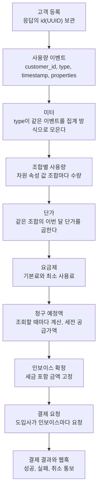

MeterEngine은 도입사 서버가 보낸 사용량 이벤트를 미터로 모아 수량을 만들고, 그 수량에 단가를 곱해 고객별 월 청구액을 계산합니다. 이 페이지는 각 단계가 무엇을 받아 무엇을 넘기는지, 그리고 한번 하면 되돌릴 수 없는 일이 어디에 있는지 설명합니다.

## 한눈에 보기



## 단계별로 하는 일

| 단계 | 누가 | 하는 일 | 자세히 |
| --- | --- | --- | --- |
| 고객 등록 | 도입사 | 청구할 고객을 등록하고 응답의 `id`를 도입사 시스템의 고객 ID와 함께 저장합니다. | [고객 등록과 ID 대응](/integration/customers) |
| 이벤트 전송 | 도입사 | 사용량이 생길 때 `POST /v1/events`로 보냅니다. 한 요청에 100건까지 묶으려면 `POST /v1/event-batches`를 씁니다. | [사용량 이벤트 보내기](/integration/events) |
| 미터 집계 | MeterEngine | 미터의 `event_type`과 이벤트의 `type`이 같은 이벤트를 미터에 정한 집계 방식(합계, 건수 등)으로 모아 고객별 월 수량을 만듭니다. | [미터 설계](/pricing/meters) |
| 조합별 사용량 | MeterEngine | 미터에 차원 속성(`dimension_properties`)이 있으면 이벤트 속성 값의 조합마다 수량을 나눕니다. | [차원과 속성 조합](/pricing/dimensions) |
| 단가 적용 | MeterEngine | 조합이 정확히 같은 단가를 찾아 수량에 곱합니다. 단가가 없는 조합의 사용량은 청구되지 않습니다. | [단가 모델과 버전](/pricing/price-models) |
| 요금제 적용 | MeterEngine | 고객에게 적용되는 요금제에 기본료나 최소 사용료이 있으면 반영합니다. 최소 사용료은 라인 금액 합이 모자란 만큼 조정 라인으로 더합니다. | [기본료와 최소 사용료](/pricing/price-plans) |
| 청구 예정액 | MeterEngine | 아직 확정하지 않은 고객의 금액을 `GET /v1/invoices/draft`를 부를 때마다 계산합니다. 세금을 뺀 공급가액입니다. | [예정액, 확정액, 수납액](/concepts/amounts) |
| 인보이스 확정 | 도입사 | 달이 끝난 뒤 콘솔의 '청구 검토' 화면이나 `POST /v1/invoices?month=YYYY-MM`으로 확정합니다. 세금을 포함한 금액이 고정됩니다. | [인보이스 수동 확정](/billing/finalize-invoices) |
| 결제 요청 | 도입사 | 확정한 인보이스마다 결제를 요청합니다. | [첫 결제 요청과 결과 확인](/payments/charging) |
| 결과와 통보 | MeterEngine | 결제 결과를 확인해 기록하고, 등록한 주소로 웹훅을 보냅니다. | [웹훅 받기 시작하기](/webhooks/overview) |

{/* 확인 필요: 확정 뒤 자동 첫 결제 없음 */}
<Note>
확정해도 결제는 자동으로 시작되지 않습니다. 확정한 뒤 인보이스마다 결제를 요청해야 합니다. [첫 결제 요청과 결과 확인](/payments/charging)을 보세요.
</Note>

{/* 확인 필요: 웹훅 data 공개 형태와 확정 통보 없음 */}
인보이스 확정을 알리는 웹훅은 없습니다. 확정 결과는 통보가 아니라 인보이스 목록 API(`GET /v1/invoices`)로 확인합니다. [웹훅 이벤트 유형과 data](/webhooks/events)

## 예시: 이벤트 하나가 금액이 되기까지

AI 서비스가 생성 요청 한 번마다 아래 이벤트를 보낸다고 해 봅니다.

```json 이벤트
{
  "transaction_id": "gen_20261105_000123",
  "customer_id": "3f6c2a8e-5b1d-4c7a-9e2f-8d4b6a1c0e57",
  "type": "llm_generation",
  "timestamp": "2026-11-05T10:00:00+09:00",
  "properties": {
    "model": "lumen-fast",
    "input_tokens": 1200,
    "output_tokens": 800
  }
}
```

<Steps>
  <Step title="미터가 이벤트를 고른다">
    `event_type`이 `llm_generation`인 미터만 이 이벤트를 집계합니다. 입력 토큰 미터(`input_tokens` 합계), 출력 토큰 미터(`output_tokens` 합계), 요청 수 미터(이벤트 건수)처럼 한 이벤트에서 여러 미터가 각자 수량을 뽑을 수 있습니다. 미터 정의는 [미터 설계](/pricing/meters)에 있습니다.
  </Step>
  <Step title="조합별로 수량을 나눈다">
    이 미터들이 모두 `model`을 차원 속성으로 두었다면, 이 이벤트의 수량은 `{"model": "lumen-fast"}` 조합에 쌓입니다. `lumen-standard` 모델 이벤트는 다른 조합에 쌓입니다.
  </Step>
  <Step title="같은 조합의 단가를 곱한다">
    입력 토큰 미터의 `{"model": "lumen-fast"}` 조합에 이번 달 단가가 있으면 그 단가를 곱한 금액이 청구 예정액의 한 라인이 됩니다. 단가가 없으면 그 조합의 수량은 금액에 들지 않고 청구 예정액의 `unpriced_usages`에 나옵니다.
  </Step>
  <Step title="고객별로 합친다">
    한 고객의 모든 라인 금액과 요금제 금액을 더한 값이 그 고객의 청구 예정액입니다. 숫자로 따라가는 예시는 [금액 계산 따라가기](/pricing/calculation-example)에 있습니다.
  </Step>
</Steps>

## 되돌릴 수 없는 제약

아래는 한번 일어나면 되돌릴 수 없거나, 순서를 잘못 잡으면 바로잡을 수 없는 일입니다. 준비 순서는 이 제약에서 나옵니다.

| 제약 | 결과 | 자세히 |
| --- | --- | --- |
| 이벤트가 들어온 미터는 이름만 바꿀 수 있습니다. | 그 미터의 `event_type`으로 이벤트가 한 건이라도 저장되면 이름(`name`) 말고 다른 필드를 바꾸려 할 때 409 `billable_metric_has_events`를 받습니다. | [미터 설계](/pricing/meters) |
| 단가는 이번 달 이후에만 넣을 수 있습니다. | 지난달 이전 시작 월로 단가를 넣으면 409 `price_rate_history_immutable`을 받습니다. 지난달 사용량에 단가가 없었다면 그 사용량은 청구할 수 없습니다. | [시간 규칙](/concepts/time-rules) |
| 등록되지 않은 고객의 이벤트는 받지 않습니다. | `customer_id`가 가리키는 고객이 없으면 404 `customer_not_found`로 거절되고 저장되지 않습니다. 고객을 등록한 뒤 다시 보내야 합니다. | [고객 등록과 ID 대응](/integration/customers) |
| 보낸 이벤트는 고치거나 지울 수 없습니다. | 같은 `transaction_id`로 다시 보내도 처음 것이 남습니다. | [사용량 이벤트 보내기](/integration/events) |
| 확정한 인보이스는 되돌릴 수 없습니다. | 확정한 뒤 그 달에 들어온 그 고객의 이벤트는 청구되지 않습니다. | [확정 뒤 바뀌는 것과 안 바뀌는 것](/billing/after-finalization) |

{/* 확인 필요: 테스트 키 정의와 mode 설명 */}
<Warning>
테스트 환경에서도 이 제약은 똑같이 적용됩니다. 테스트 환경도 보낸 이벤트와 확정한 인보이스는 되돌릴 수 없습니다. 시험하는 방법은 [업무 환경](/concepts/environments)을 보세요.
</Warning>

## 안전한 준비 순서

<Steps>
  <Step title="미터를 만든다">
    이벤트의 `type`과 집계할 속성, 단가를 나눌 차원 속성을 정해 미터를 만듭니다. 이벤트가 들어오면 이름 말고는 바꿀 수 없으므로 이벤트보다 먼저 확정합니다. [미터 설계](/pricing/meters)
  </Step>
  <Step title="이번 달 단가를 등록한다">
    미터의 조합마다 이번 달부터 적용할 단가를 넣습니다. 필요하면 기본료와 최소 사용료도 정합니다. [단가 모델과 버전](/pricing/price-models), [기본료와 최소 사용료](/pricing/price-plans)
  </Step>
  <Step title="고객을 등록한다">
    고객을 등록하고 응답의 `id`를 저장합니다. 고객 등록에는 미터가 필요하지 않으므로 이 단계는 미터와 단가보다 먼저 해도 됩니다. [고객 등록과 ID 대응](/integration/customers)
  </Step>
  <Step title="이벤트를 보낸다">
    저장한 고객 `id`를 `customer_id`에 넣어 이벤트를 보냅니다. [사용량 이벤트 보내기](/integration/events)
  </Step>
  <Step title="청구 예정액으로 확인한다">
    콘솔의 '청구 검토' 화면이나 `GET /v1/invoices/draft`로 금액이 생각한 대로 나오는지 봅니다. [보낸 데이터 확인하기](/integration/verify-usage)
  </Step>
</Steps>

미터를 이벤트보다 늦게 만들어도 그 `type`으로 이미 저장된 이벤트는 집계됩니다. 하지만 지난달 단가는 넣을 수 없으므로, 달이 바뀐 뒤 미터를 만들면 지난달 사용량은 청구할 수 없습니다.

{/* 확인 필요: 개요 체크리스트 완료 조건 */}
<Note>
콘솔의 '개요' 화면 목록과 https://meterengine.com 첫 화면은 고객 연결을 먼저 보여 줍니다. '개요' 화면의 목록은 진행 표시이며 순서를 따를 필요는 없습니다. 고객은 미터보다 먼저 등록해도 되지만, 이벤트는 미터와 단가를 만든 뒤에 보내세요. 자세한 내용은 [빠른 시작](/quickstart)을 보세요.
</Note>

## 제약은 업무 환경마다 따로입니다

위 제약은 업무 환경마다 따로 적용됩니다. 테스트 환경의 미터에 이벤트가 들어와도 실제 환경의 같은 code 미터에는 영향이 없습니다. 고객, 미터, 단가는 업무 환경마다 따로 만들어야 하므로 실제 환경에서도 같은 순서로 다시 준비합니다. [업무 환경](/concepts/environments)을 보세요.

## 다음에 읽을 페이지

<CardGroup cols={2}>
  <Card title="업무 환경" icon="layer-group" href="/concepts/environments">
    테스트 환경과 실제 환경이 무엇을 나누는지 봅니다.
  </Card>
  <Card title="시간 규칙" icon="clock" href="/concepts/time-rules">
    청구 월, 이벤트를 받는 기간, 집계 마감 시각을 봅니다.
  </Card>
  <Card title="예정액, 확정액, 수납액" icon="receipt" href="/concepts/amounts">
    화면과 API의 금액이 각각 무엇인지 봅니다.
  </Card>
  <Card title="빠른 시작" icon="rocket" href="/quickstart">
    이 순서를 테스트 환경에서 직접 따라 합니다.
  </Card>
</CardGroup>
