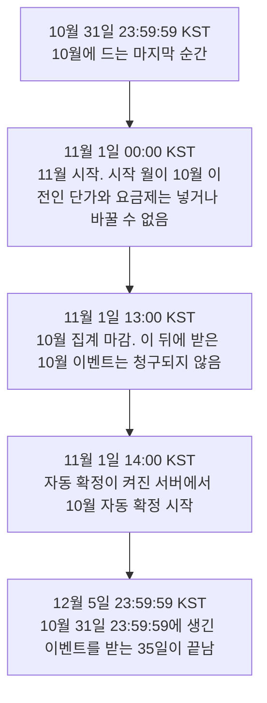

MeterEngine의 달과 시각 기준은 한국 시간(KST, UTC+09:00)입니다. 이 페이지의 시각은 따로 적지 않으면 KST입니다.

## 청구 월

청구 월은 한국 시간(KST) 기준 달력 월입니다. 한 달은 1일 00:00 KST에 시작하고 다음 달 1일 00:00 KST 직전에 끝납니다. 이벤트가 어느 달에 드는지는 이벤트의 `timestamp`로 정합니다.

| `timestamp` | 같은 순간의 KST | 드는 달 |
| --- | --- | --- |
| `2026-10-31T23:59:59+09:00` | 10월 31일 23:59:59 | 2026-10 |
| `2026-11-01T00:00:00+09:00` | 11월 1일 00:00:00 | 2026-11 |
| `2026-10-31T15:30:00Z` | 11월 1일 00:30:00 | 2026-11 |

`timestamp`는 어떤 오프셋으로 보내도 됩니다. MeterEngine은 오프셋으로 순간을 정한 뒤 그 순간을 KST로 바꿔 달을 정하므로, 같은 순간이면 오프셋과 관계없이 같은 달에 듭니다.

<Warning>
도입사 쪽에서 월별 사용량을 UTC 기준으로 세면 매달 1일 00:00부터 09:00 KST 사이의 사용량이 MeterEngine과 다른 달에 들어갑니다. 고객에게 보여 주는 월별 집계나 대조용 집계도 KST 달력 월로 세세요.
</Warning>

API의 `month` 값(`YYYY-MM`)도 KST 달력 월입니다. `month`를 생략할 수 있는 API에서 생략하면 지금 KST 기준 이번 달입니다.

## 이벤트를 받는 기간

이벤트는 MeterEngine이 받은 시각을 기준으로 `timestamp`가 35일보다 오래되지 않았으면 받습니다. 하루는 24시간으로 세고, 정확히 35일 전인 이벤트는 받습니다. 한 건씩 보낼 때와 묶어 보낼 때 기준이 같습니다.

35일보다 오래된 이벤트는 `event_too_old`로 거절되고 저장되지 않습니다. 한 건씩 보내면 400 응답을 받고, 묶어 보내면 그 원소의 결과가 `rejected`이고 `error.code`가 `event_too_old`입니다. 같은 이벤트를 다시 보내도 받지 않으니 재전송 대상에서 빼세요. [사용량 이벤트 보내기](/integration/events)

```json 400 응답 본문(한 건씩 보낼 때)
{
  "code": "event_too_old",
  "message": "받는 기간이 지난 이벤트입니다",
  "errors": [
    { "field": "timestamp", "message": "수집 판정 시각보다 35일 넘게 과거인 시각입니다" }
  ]
}
```

이미 저장된 `transaction_id`로 다시 보낸 경우에는 `timestamp`가 35일을 넘었어도 거절하지 않고 200과 `"duplicate": true`로 답합니다.

`timestamp`가 미래 시각인 이벤트도 받아서 저장합니다. 다만 그 시각이 지나기 전에는 사용량과 청구 예정액에 들지 않습니다. 조회한 달에 든 미래 시각 이벤트 가운데 아직 집계되지 않은 수는 `GET /v1/unbilled-events`의 `future_timestamp`로 볼 수 있습니다.

## 집계 마감

한 달의 사용량은 다음 달 1일 13:00 KST까지 MeterEngine이 받은 이벤트로 셉니다. 기준은 `timestamp`가 아니라 서버가 받은 시각(`received_at`)입니다. 이 시각을 집계 마감이라고 부릅니다. 콘솔의 '사용량' 화면과 '청구 검토' 화면 위에는 마감 전에는 '집계 마감'으로 마감 예정 시각이, 마감 뒤에는 '집계 기준'으로 그 시각까지 받은 사용량이라는 표시가 나옵니다.

마감 뒤에 받은 그 달 이벤트는 저장되지만 사용량, 청구 예정액, 인보이스 어디에도 들지 않습니다. 다음 달로 넘어가지도 않습니다.

<Warning>
35일 수집 기간과 집계 마감은 기준이 다릅니다. 예를 들어 10월 31일에 생긴 이벤트를 11월 3일에 보내면 35일 안이라 200으로 저장되지만, 10월 마감(11월 1일 13:00 KST)이 지났으므로 10월 청구에 들지 않고, 10월 이벤트라 11월 청구에도 들지 않습니다. 응답이 성공이어도 청구되지 않으니, 지난달 이벤트를 재전송하는 작업은 다음 달 1일 13:00 KST 전에 끝내세요.
</Warning>

마감 뒤에 받은 이벤트를 찾으려면 콘솔의 '수집 로그' 화면에서 정렬 기준을 '수신 시각'으로 바꾸거나, `GET /v1/events` 응답의 `received_at`을 봅니다. 재전송 설계는 [재전송 설계](/integration/retries)를 보세요.

## 단가와 요금제를 넣을 수 있는 달

단가는 이번 달 이후에만 넣을 수 있습니다. 매달 1일 00:00 KST가 되면 지난달은 "지난 달"이 되어, 시작 월(`effective_from`)이 지난달 이전인 단가를 넣거나 바꾸려 하면 409 `price_rate_history_immutable`을 받습니다. 기본료와 최소 사용료(요금제)도 같고, 이때는 409 `price_plan_history_immutable`을 받습니다.

<Warning>
매달 1일 00:00부터 13:00 KST 사이에는 지난달 이벤트는 아직 받지만 지난달 단가는 더는 넣을 수 없습니다. 단가가 없는 조합의 지난달 사용량은 그대로 청구되지 않으니, 새 미터나 새 차원 값을 쓰기 시작한 달에는 그 달이 끝나기 전에 단가를 등록하세요.
</Warning>

단가 버전과 적용 월은 [단가 모델과 버전](/pricing/price-models)에서 다룹니다.

## 확정 시각

수동 확정은 언제든 할 수 있습니다. 집계 마감 전에 확정하면 그 순간까지 받은 이벤트로 확정하고, 그 뒤에 들어온 그 고객의 그 달 이벤트는 청구되지 않습니다. 그래서 지난달은 다음 달 1일 13:00 KST가 지난 뒤 확정하는 것이 안전합니다. [인보이스 수동 확정](/billing/finalize-invoices)

{/* 확인 필요: 배포 서버 자동 확정 켜는 시점 */}
자동 확정은 켜져 있을 때 다음 달 1일 14:00 KST 이후에 돕니다. 서버에서 켜져 있으면 14:00 KST 정시부터 매시 정각에 확정 시각이 지난 달을 확정합니다. 지금 쓰는 서버에서 켜져 있는지는 청구 예정액 응답(`GET /v1/invoices/draft`)의 `auto_finalize_enabled`로 확인합니다. 동작은 [자동 확정과 보류](/billing/auto-finalization)를 보세요.

## 월말 타임라인

10월 사용량을 예로 들면 다음과 같습니다.



## 예약 작업

MeterEngine이 정해진 시각에 스스로 하는 일입니다.

| 언제 | 하는 일 | 자세히 |
| --- | --- | --- |
| 매분 | 결과가 확인되지 않은 결제를 토스페이먼츠에 다시 조회합니다. | [첫 결제 요청과 결과 확인](/payments/charging) |
| 10분마다 | 다시 시도할 때가 된 실패 결제를 다시 시도합니다. | [결제 실패와 재시도](/payments/retries) |
| 매일 04:00 KST | 토스페이먼츠 거래 내역과 MeterEngine 결제 기록을 맞춰 봅니다(대사). | [수납 상태와 대사 확인](/payments/reconciliation) |
| 매일 09:00 KST | 청구에서 빠진 사용량이 있고 이 통보를 받도록 등록한 수신 주소가 있으면 `unbilled_usage_detected` 웹훅을 보냅니다. 지난달과 이번 달을 따로 보냅니다. | [웹훅 이벤트 유형과 data](/webhooks/events) |
| 매시 정각 | 자동 확정이 켜진 서버에서 확정 시각이 지난 달을 확정합니다. | [자동 확정과 보류](/billing/auto-finalization) |

웹훅 발송이 실패했을 때 다시 보내는 간격은 [전송, 재전송, 중복 처리](/webhooks/delivery-and-retries)에 있습니다.

## 자리마다 뜻이 다른 cutoff_at

응답에 나오는 `cutoff_at`은 자리에 따라 뜻이 다릅니다.

| 나오는 곳 | 뜻 |
| --- | --- |
| 인보이스(`GET /v1/invoices`, `GET /v1/invoices/{id}`) | 확정이 읽은 이벤트의 받은 시각 상한입니다. 그 달에 생겼고 이 시각 전에 받은 이벤트만 금액에 들었습니다. 마감 뒤에 확정했으면 다음 달 1일 13:00 KST, 마감 전에 확정했으면 확정한 시각입니다. |
| 청구 제외 사용량(`GET /v1/unbilled-events`)과 `unbilled_usage_detected` 웹훅 | 이벤트가 생긴 시각(`timestamp`)의 상한입니다. 지금 시각과 그 달의 끝 중 이른 쪽이며, 이 시각 이후의 `timestamp`를 가진 이벤트가 미래 시각 이벤트로 세어집니다. |

## 다른 페이지의 기간 값

| 값 | 기간 | 자세히 |
| --- | --- | --- |
| 콘솔 로그인 유지 | 12시간 | [화면과 API, 권한](/authentication/scopes) |
| API 키 교체 뒤 기존 키를 더 쓸 수 있는 시간 | 24시간 | [키 교체, 권한 변경, 폐기](/authentication/key-rotation) |
| 구성원 초대 링크 | 발급 뒤 48시간 | [구성원과 권한](/account/members) |
| 카드 등록 링크 | 발급 뒤 24시간 | [고객 카드 등록 링크](/payments/card-registration) |
