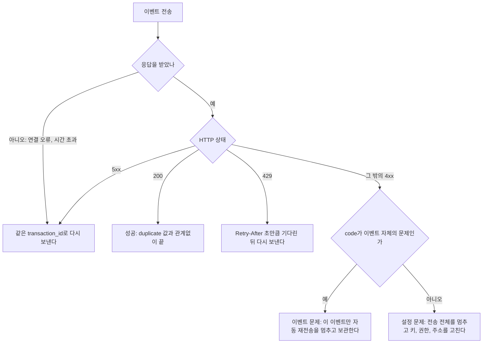

네트워크 오류나 서버 오류로 이벤트를 보내지 못하면 그 사용량은 청구되지 않습니다. 이 페이지는 보내지 못한 이벤트를 잃지 않고, 같은 이유로 계속 거절될 이벤트를 끝없이 다시 보내지 않게 하는 방법을 다룹니다.

같은 `transaction_id`로 다시 보내면 MeterEngine은 처음 저장한 이벤트를 유지하고 `200`과 `duplicate: true`로 답합니다. 그래서 응답을 받지 못했을 때는 같은 `transaction_id`로 다시 보내면 됩니다. 멱등 규칙 전체는 [멱등 규칙](/api-basics/idempotency)에 있습니다.

MeterEngine은 SDK를 배포하지 않으므로 아래 판정과 아웃박스는 자사 코드에 직접 구현합니다. 예시 코드는 Node 기준입니다.

## 다시 보낼지 판단하기



### 다시 보낼 것

| 상황 | code | 할 일 |
| --- | --- | --- |
| 연결 오류, 응답 시간 초과 | | 저장됐는지 알 수 없습니다. 같은 `transaction_id`로 다시 보냅니다 |
| 429 | `rate_limit_exceeded` | `Retry-After` 헤더의 초만큼 기다린 뒤 다시 보냅니다. [요청 한도](/api-basics/rate-limits)를 보세요 |
| 500 | `internal_server_error` | 간격을 늘려 가며 같은 `transaction_id`로 다시 보냅니다 |
| 그 밖의 5xx | | 본문에 `code`가 없을 수도 있습니다. 저장됐는지 알 수 없으니 같은 `transaction_id`로 다시 보냅니다 |

### 멈출 것: 이벤트 자체의 문제

아래 code는 같은 이벤트를 그대로 다시 보내도 같은 이유로 거절됩니다. 자동 재전송을 멈추고, 이벤트를 지우지 말고 따로 보관한 뒤 원인을 고칩니다.

| 상태 | code | 원인 | 할 일 |
| --- | --- | --- | --- |
| 400 | `validation_error` | 필수 필드가 없거나 형식이 틀렸습니다 | `errors`의 `field`를 보고 이벤트를 만드는 코드를 고칩니다 |
| 400 | `malformed_request_body` | 본문이 JSON이 아니거나 값의 타입이 맞지 않습니다(`timestamp`에 오프셋이 없는 경우 등) | 직렬화 코드를 고칩니다 |
| 400 | `event_too_old` | `timestamp`가 받은 시각보다 35일 넘게 과거입니다 | 이 이벤트는 더 받지 않습니다. 다시 보내지 않습니다 |
| 404 | `customer_not_found` | `customer_id`의 고객이 이 업무 환경에 없습니다 | 고객 id와 키의 업무 환경을 확인합니다. 테스트 환경 고객 id를 실제 환경 키로 보내면 이 code입니다 |
| 409 | `customer_archived` | 고객을 보관했습니다 | 보관이 의도였다면 버립니다. 실수였다면 고객을 복원한 뒤 같은 `transaction_id`로 다시 보냅니다 |

`customer_not_found`는 고객 id를 바로잡은 이벤트로 다시 보내면 풀립니다. 이때 `customer_id`만 바꾸고 `transaction_id`와 `timestamp`는 그대로 둡니다. 고객 id를 다시 찾는 법은 [고객 등록과 ID 대응](/integration/customers)에 있습니다.

### 멈출 것: 요청 전체의 문제

`401`(`authentication_required`, `invalid_credentials`), `403`(`permission_denied`, `organization_not_active`, `environment_mismatch`), `404 endpoint_not_found`, `405 method_not_allowed`, `415 request_type_not_supported`는 이벤트가 아니라 키, 권한, 주소, 헤더의 문제입니다. 이 응답을 받으면 이후 이벤트도 모두 같은 응답을 받습니다. 이벤트는 그대로 쌓아 두고 전송을 멈춘 뒤, 설정을 고치고 다시 시작합니다. code별 뜻은 [오류 응답](/api-basics/errors)에 있습니다.

<Note>위 분류는 지금 응답 code의 뜻에 따라 이 가이드가 권하는 기준입니다. 모르는 code를 받으면 멈추고 보관하는 쪽으로 처리하세요.</Note>

### 판정 코드

```javascript Node
// 같은 이벤트를 다시 보내도 같은 이유로 거절되는 code
const PERMANENT = new Set([
  "validation_error",
  "malformed_request_body",
  "event_too_old",
  "customer_not_found",
  "customer_archived",
]);

// 반환: "done" | "retry" | "hold" | "stop"
function decide(status, body) {
  if (status === 200) return "done";
  if (status === 429 || status >= 500) return "retry";
  if (PERMANENT.has(body?.code)) return "hold"; // 이 이벤트만 보관
  return "stop"; // 키, 권한, 주소 문제: 전송 전체를 멈춘다
}

function retryAfterMs(response) {
  const seconds = Number(response.headers.get("Retry-After"));
  return Number.isInteger(seconds) && seconds > 0 ? seconds * 1000 : undefined;
}
```

## 묶음 결과는 원소마다 판단한다

`POST /v1/event-batches`는 원소 일부가 거절돼도 `200`을 줍니다. 요청 전체의 상태로 위 판정을 한 번 하고, `200`이면 `results`를 원소마다 봅니다.

| 원소 `result` | 할 일 |
| --- | --- |
| `stored`, `duplicate` | 성공. 아웃박스에서 지웁니다 |
| `rejected` | `error.code`로 위 "이벤트 자체의 문제" 표를 따릅니다 |

묶음 요청 전체가 연결 오류, `429`, `5xx`로 실패하면 같은 원소를 같은 `transaction_id`로 묶어 다시 보냅니다. 이미 저장된 원소는 `duplicate`로 돌아옵니다. 묶음 형식은 [사용량 이벤트 보내기](/integration/events)를 보세요.

```javascript Node
const { results } = await response.json();
for (const item of results) {
  const event = batch[item.index];
  if (item.result === "stored" || item.result === "duplicate") markDelivered(event);
  else if (PERMANENT.has(item.error.code)) markHeld(event, item.error.code);
  else markRetry(event);
}
```

## 아웃박스로 잃지 않게 하기

사용량을 기록한 뒤 바로 MeterEngine을 부르면, 그 사이 프로세스가 죽거나 네트워크가 끊길 때 이벤트가 사라집니다. 보낼 이벤트를 먼저 자사 데이터베이스에 저장해 두고 따로 보내는 방식(아웃박스)을 권합니다.

<Steps>
<Step title="사용 기록과 같은 트랜잭션에 이벤트를 저장한다">
고객의 사용을 자사 데이터베이스에 기록하는 트랜잭션 안에서, 보낼 이벤트 본문(`transaction_id`, `customer_id`, `type`, `timestamp`, `properties`)을 아웃박스 테이블에 함께 넣습니다. 사용은 기록됐는데 이벤트는 없는 상태가 생기지 않습니다.
</Step>
<Step title="별도 작업이 아웃박스를 보낸다">
주기적으로 보내지 않은 이벤트를 꺼내 한 건씩 또는 100건까지 묶어 보냅니다. 다시 보낼 때도 저장해 둔 본문을 그대로 씁니다.
</Step>
<Step title="결과에 따라 상태를 바꾼다">
`done`이면 보냄으로 표시합니다. `retry`면 다음 시도 시각을 정해 남겨 둡니다(429는 `Retry-After`, 그 밖에는 간격을 늘려 가며). `hold`면 code와 함께 보관 상태로 바꿔 자동 재전송에서 뺍니다. `stop`이면 전송 작업을 멈추고 담당자에게 알립니다.
</Step>
<Step title="보관한 이벤트를 처리한다">
원인을 고친 뒤 다시 보낼 이벤트만 사람이 골라 보냅니다. `event_too_old`는 다시 보내지 않습니다.
</Step>
</Steps>

<Warning>
다시 보낼 때 `transaction_id`나 `timestamp`를 새로 만들지 마세요. `transaction_id`를 바꾸면 이미 저장된 이벤트가 한 번 더 저장되어 이중 청구됩니다. `timestamp`를 보내는 시각으로 바꾸면 사용량이 다른 달로 옮겨 갑니다.
</Warning>

## 다시 보낼 수 있는 기한

재전송에는 아래 기한이 있습니다.

| 기한 | 지나면 |
| --- | --- |
| 다음 달 1일 13:00 KST (집계 마감) | 지난달 이벤트를 `200`으로 저장하지만 지난달 금액에 들어가지 않습니다 |
| `timestamp`로부터 35일 | `400 event_too_old`로 거절합니다 |

달의 첫 시각에 일어난 이벤트도 집계 마감까지는 35일이 되지 않으므로, 청구에 넣으려면 언제나 집계 마감이 먼저 오는 기한입니다.

<Warning>
마감 뒤에 받은 지난달 이벤트는 오류 없이 `200`으로 저장되므로 응답만 보고는 청구되지 않은 것을 알 수 없습니다. 월말과 1일 오전에는 아웃박스가 비었는지 확인하고, 1일 13:00 KST 전에 밀린 이벤트를 모두 보내세요.
</Warning>

마감 뒤에 도착한 이벤트의 건수를 한 번에 보는 조회는 없습니다. read 권한 키로 `GET /v1/events?month=YYYY-MM&sort=received_at&order=desc`를 불러 받은 시각이 늦은 이벤트부터 `received_at`을 하나씩 확인합니다. 시각 기준은 [시간 규칙](/concepts/time-rules), 확인 방법은 [보낸 데이터 확인하기](/integration/verify-usage)를 보세요.

## 거절된 이벤트 찾기

MeterEngine은 단건 요청의 `customer_not_found`, `customer_archived`, `event_too_old` 거절과 묶음 요청의 `rejected` 원소를 수집 거절 기록으로 남깁니다. 콘솔 '수집 거절' 화면이나 read 권한 키로 `GET /v1/event-rejections/search`를 불러 봅니다. `month`(기록한 달, `YYYY-MM`, 생략하면 이번 달), `customer_id`, `error_code`, `q`(`transaction_id`나 `type`의 일부), `page`, `size`로 좁힐 수 있고, 결과마다 `transaction_id`, `error_code`, `error_fields`, `request_id`, 묶음 요청이면 `batch_index`가 있습니다.

단건 요청의 JSON 파싱 오류와 형식 검증 오류(`malformed_request_body`, `validation_error`), 묶음 요청 전체가 `400`으로 거절된 경우, 인증과 한도 거절은 기록되지 않습니다. 이 응답은 본문과 응답 헤더 `X-Request-ID`를 자사 로그에 남겨 두세요.

이벤트 수집 요청은 감사 기록에 나오지 않으니 `request_id`와 `transaction_id`로 찾습니다. [오류 응답](/api-basics/errors)을 보세요.
