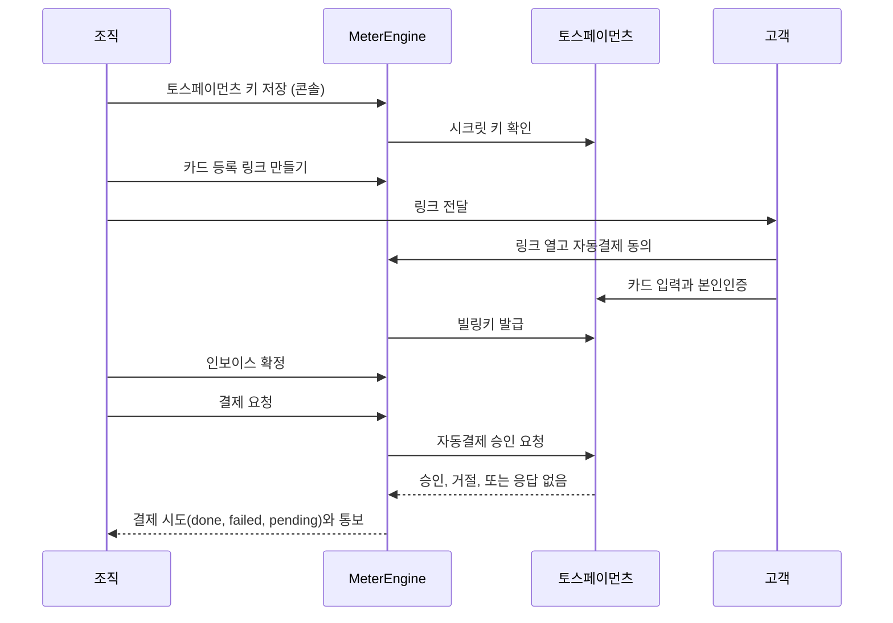

MeterEngine은 토스페이먼츠 자동결제(빌링)로 확정 인보이스를 결제합니다. 고객이 카드를 한 번 등록해 두면, 결제를 요청할 때마다 MeterEngine이 그 카드로 인보이스의 세금 포함 금액을 청구합니다.

{/* 확인 필요: 확정 뒤 자동 첫 결제 없음 */}
<Warning>
인보이스를 확정해도 결제는 자동으로 시작되지 않습니다. 확정한 뒤 인보이스마다 결제를 요청해야 합니다. 자세한 방법은 [첫 결제 요청과 결과 확인](/payments/charging)에 있습니다.
</Warning>

## 누가 무엇을 하나

| 하는 일 | 조직 | MeterEngine | 고객 |
| --- | --- | --- | --- |
| 토스페이먼츠 상점 가입, 실결제용 자동결제 계약 | 합니다 | | |
| 실제 환경 이용 신청(실결제 키 제출) | 합니다 | 확인하고 승인합니다 | |
| 토스페이먼츠 키 저장, 토스페이먼츠 웹훅 등록 | 합니다 | | |
| 카드 등록 링크 만들기와 전달 | 합니다 | 링크를 만듭니다 | |
| 카드 입력, 본인인증, 자동결제 동의 | | 화면을 제공합니다 | 합니다 |
| 빌링키 발급과 암호화 보관 | | 합니다 | |
| 인보이스 확정 | 합니다 | | |
| 결제 요청 | 합니다 | 토스페이먼츠에 승인을 요청합니다 | |
| 결과를 확인하지 못한 결제와 취소의 재조회 | | 합니다 | |
| 실패한 결제의 자동 재시도 | | 조건에 맞으면 합니다 | |
| 매일 대사 | | 합니다 | |
| 인보이스 조회 링크 만들기와 전달 | 합니다 | 링크와 조회 화면을 제공합니다 | 봅니다 |
| 결제 취소 | 합니다 | 토스페이먼츠에 취소를 요청합니다 | |

{/* 확인 필요: 확정 뒤 자동 첫 결제 없음 */}
MeterEngine이 스스로 도는 결제 작업은 결과를 확인하지 못한 결제와 취소의 재조회, 실패한 결제의 재시도, 매일 대사뿐입니다. 모두 콘솔이나 API로 한 번 요청한 결제를 이어서 처리하는 일이고, 요청한 적 없는 인보이스를 새로 결제하지 않습니다. 예약 작업 시각은 [시간 규칙](/concepts/time-rules) 페이지에 모았습니다.

MeterEngine은 카드 등록 링크와 인보이스 조회 링크를 메일로 보내지 않으니 고객에게 직접 전달합니다.

## 흐름

## 순서

<Steps>
  <Step title="토스페이먼츠 키를 저장한다">
    토스페이먼츠 개발자센터에서 API 개별 연동 키를 확인해 콘솔 '조직 설정' 화면에 저장하고, 토스페이먼츠 웹훅 주소를 등록합니다. [토스페이먼츠 상점 준비와 키 저장](/payments/toss-setup)
  </Step>
  <Step title="고객에게 카드를 등록받는다">
    고객마다 카드 등록 링크를 만들어 전달합니다. 인보이스를 확정하기 전에 해 두어도 됩니다. [고객 카드 등록 링크](/payments/card-registration)
  </Step>
  <Step title="인보이스를 확정한다">
    달이 끝난 뒤 인보이스를 확정합니다. 확정한 금액만 결제할 수 있습니다. [인보이스 수동 확정](/billing/finalize-invoices)
  </Step>
  <Step title="결제를 요청하고 결과를 확인한다">
    인보이스마다 결제를 요청하고 결과를 확인합니다. [첫 결제 요청과 결과 확인](/payments/charging)
  </Step>
  <Step title="실패와 취소를 처리한다">
    실패한 결제는 조건에 맞으면 자동으로 다시 시도합니다. [결제 실패와 재시도](/payments/retries), [결제 취소](/payments/cancellations)
  </Step>
  <Step title="고객에게 인보이스를 보여 준다">
    인보이스 조회 링크를 만들어 고객에게 전달합니다. [고객에게 인보이스 보여 주기](/payments/invoice-links)
  </Step>
</Steps>

## 콘솔에서 하는 일과 API로 하는 일

{/* 확인 필요: API 참조에서 숨기는 범위 */}
토스페이먼츠 키 저장과 보관은 콘솔에 로그인한 상태에서만 됩니다. API 키로 부르면 거절됩니다. 나머지는 콘솔에서도, API 키로도 할 수 있습니다.

| 하는 일 | 콘솔 | API (필요 권한) |
| --- | --- | --- |
| 토스페이먼츠 키 저장, 보관 | '조직 설정' 화면 | 안 됨 |
| 토스페이먼츠 키 목록, 결제 모드 조회 | '조직 설정' 화면 | `GET /v1/toss-payments-credentials`, `GET /v1/payment-setting` (read) |
| 카드 등록 링크 만들기 | 고객 상세 화면 | `POST /v1/customers/{id}/payment-method-registrations` (admin) |
| 고객 카드 조회 | 고객 상세 화면 | `GET /v1/customers/{id}/payment-method` (read) |
| 결제 요청 | '수납과 취소' 화면의 고객별 수납 화면 | `POST /v1/invoices/{id}/payment-attempts` (admin) |
| 결제 시도와 수납 상태 조회 | '수납과 취소' 화면 | `GET /v1/invoices/{id}/payment-attempts`, `GET /v1/invoice-payments` (read) |
| 결제 취소 | 고객별 수납 화면 | `POST /v1/payment-attempts/{id}/cancellations` (admin) |
| 인보이스 조회 링크 만들기 | 고객별 수납 화면 | `POST /v1/invoices/{id}/view-links` (admin) |

권한의 뜻은 [화면과 API, 권한](/authentication/scopes)에 있습니다. 엔드포인트의 요청과 응답 형식은 [API 참조](/api-reference/introduction)에서 확인합니다.

## 업무 환경과 결제 모드

토스페이먼츠 키, 등록 카드, 결제 시도는 업무 환경마다 따로입니다. 테스트 환경은 토스페이먼츠 테스트 키로만 결제하고, 실제 환경은 실결제 키로만 결제합니다. 두 환경을 어떻게 나눠 쓰는지는 [테스트 결제와 실결제](/payments/test-and-live)에 있습니다.

<CardGroup cols={2}>
  <Card title="토스페이먼츠 키 저장" href="/payments/toss-setup">
    상점 준비, 키 저장, 토스페이먼츠 웹훅 등록
  </Card>
  <Card title="첫 결제 요청" href="/payments/charging">
    결제 요청, 결과 읽기, 다시 요청하기 전 확인할 것
  </Card>
</CardGroup>
