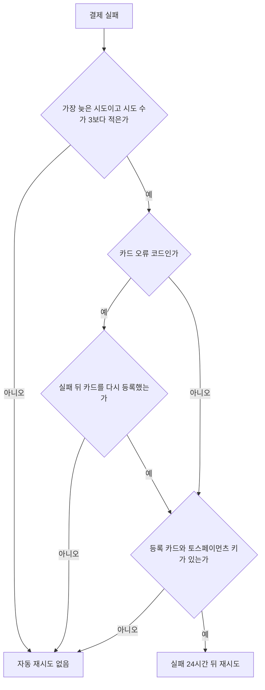

실패한 결제를 다시 시도하는 길은 아래와 같습니다.

| 누가 | 어디서 | 기다리는 시간 | 시도 수 상한 |
| --- | --- | --- | --- |
| MeterEngine(자동 재시도) | 예약 작업 | 실패하고 24시간 뒤 | 있음 |
| 고객(링크 재시도) | 재시도를 허용한 고객 조회 링크 화면 | 없음 | 있음 |
| 도입사(재요청) | 콘솔 '수납과 취소' 화면 또는 API | 없음 | 없음 |

모든 길이 같은 시도 수를 셉니다. 시도 수는 한 인보이스에 같은 결제 모드로 한 결제 시도 전부이고, 첫 결제 요청도 들어갑니다. 상한은 3번이라 첫 결제가 실패하면 자동 재시도나 고객 재시도는 최대 2번 더 일어납니다.

{/* 확인 필요: 확정 뒤 자동 첫 결제 없음 */}
첫 결제는 도입사가 요청해야 시작됩니다. 재시도는 그렇게 요청한 결제가 실패했을 때만 일어납니다. 첫 결제 요청은 [첫 결제 요청과 결과 확인](/payments/charging)을 보세요.

<Note>결과 확인 중(`pending`)인 결제는 실패가 아닙니다. MeterEngine이 결과를 다시 확인하니 다시 요청하지 마세요. 자세한 동작은 [첫 결제 요청과 결과 확인](/payments/charging)에 있습니다.</Note>

## 실패를 확인하기

필요 권한: read(조회)

콘솔에서는 '수납과 취소' 화면에서 달을 고르면 인보이스마다 '수납 상태', '실패 코드', '다음 재시도'가 보입니다. 고객 이름을 누르면 수납 상세 화면의 '결제 시도 기록'에 시도마다 결과와 실패 사유가 나옵니다.

API로는 인보이스별 결제 상태와 결제 시도 목록을 조회합니다.

<CodeGroup>

```bash cURL
curl "https://meterengine.com/v1/invoice-payments?month=2026-10" \
  -H "Authorization: Bearer me_test_xxxxxxxx"
```

```javascript Node
const res = await fetch(
  "https://meterengine.com/v1/invoice-payments?month=2026-10",
  { headers: { Authorization: "Bearer me_test_xxxxxxxx" } },
);
const { invoice_payments } = await res.json();
const failed = invoice_payments.filter((p) => p.status === "failed");
```

</CodeGroup>

```json 응답 200
{
  "invoice_payments": [
    {
      "invoice_id": "7b0c2f4e-5a1d-4c8e-9f3b-2d6a8e1c4b70",
      "status": "failed",
      "mode": "test",
      "amount": 55000,
      "canceled_amount": 0,
      "attempt_count": 1,
      "last_failure_code": "REJECT_CARD_COMPANY",
      "next_retry_at": "2026-11-02T10:15:30+09:00",
      "completed_at": "2026-11-01T10:15:30+09:00"
    }
  ]
}
```

<ResponseField name="last_failure_code" type="string">
  가장 늦게 요청한 시도가 실패했을 때만 있습니다. 그 시도의 `failure_code`입니다.
</ResponseField>
<ResponseField name="next_retry_at" type="string">
  자동 재시도가 예정된 시각입니다. 실패 시각(`completed_at`)에 24시간을 더한 값입니다. 가장 늦은 시도가 실패했고 시도 수, 카드 오류, 등록 카드 조건(아래 자동 재시도 조건)을 만족할 때만 있습니다. 없으면 자동 재시도가 일어나지 않습니다. 토스페이먼츠 키 상태는 보지 않으니 아래 '자동 재시도를 멈추는 것'을 함께 보세요.
</ResponseField>
<ResponseField name="attempt_count" type="integer">
  지금 결제 모드로 이 인보이스에 한 결제 시도 수입니다. 3이면 자동 재시도와 고객 재시도가 더 일어나지 않습니다.
</ResponseField>

시도마다 실패 사유를 보려면 `GET /v1/invoices/{id}/payment-attempts`를 부릅니다. 요청 시각이 늦은 것부터 나옵니다.

```json 응답 200
{
  "payment_attempts": [
    {
      "id": "a1e4c7d2-6b3f-4a8e-9c1d-5f2b8e7a0c13",
      "invoice_id": "7b0c2f4e-5a1d-4c8e-9f3b-2d6a8e1c4b70",
      "mode": "test",
      "status": "failed",
      "amount": 55000,
      "payment_key": null,
      "failure_code": "REJECT_CARD_COMPANY",
      "failure_message": "토스페이먼츠가 돌려준 거절 문구",
      "requested_at": "2026-11-01T10:15:28+09:00",
      "completed_at": "2026-11-01T10:15:30+09:00"
    }
  ]
}
```

`failure_code`에는 토스페이먼츠의 거절 코드가 그대로 들어가고, 아래 값은 토스페이먼츠 거절 코드가 아닙니다.

| failure_code | 뜻 |
| --- | --- |
| `HTTP_<상태>` | 토스페이먼츠 거절 응답에 코드가 없어 HTTP 상태를 남겼습니다 |
| `NOT_FOUND_PAYMENT` | 결제를 요청하고 10분이 지나도 토스페이먼츠에서 주문을 찾지 못했습니다. 토스페이먼츠의 거절이 아니라 MeterEngine의 판정입니다 |
| `ABORTED`, `EXPIRED` | 결과 확인 중이던 결제를 토스페이먼츠 주문 조회로 확인했더니 승인 없이 끝난 상태였습니다. 토스페이먼츠가 준 결제 상태 값입니다 |
| `toss_payments_credential_missing` | 토스페이먼츠를 부르기 전에 결제 모드의 토스페이먼츠 키가 없었습니다 |
| `payment_method_missing` | 토스페이먼츠를 부르기 전에 고객의 등록 카드가 없었습니다 |

{/* 확인 필요: 웹훅 data 공개 형태와 확정 통보 없음 */}
웹훅 `payment_failed`에는 실패 사유가 실리지 않으니 통보를 받으면 위 API로 사유를 확인합니다. 통보 형식은 [웹훅 이벤트 유형과 data](/webhooks/events)에 있습니다.

## 자동 재시도

MeterEngine은 실패한 결제가 아래 조건을 모두 만족하면 실패 시각에서 24시간이 지난 뒤 처음 도는 재시도 작업 때 다시 결제합니다. 재시도 작업의 주기는 [시간 규칙](/concepts/time-rules)에 모았습니다.

- 실패한 시도가 그 인보이스에서 가장 늦게 요청한 시도입니다.
- 시도 수가 3보다 적습니다.
- 고객에게 지금 결제 모드로 등록한 카드가 있습니다.
- 도입사 설정의 토스페이먼츠 키가 보관되지 않고 저장되어 있습니다.
- 실패 코드가 아래 카드 오류가 아닙니다. 카드 오류여도 실패한 뒤 고객이 카드를 다시 등록했으면 다시 시도합니다.
- `NOT_FOUND_PAYMENT` 실패는 실패한 지 7일 안이고, 토스페이먼츠에 다시 물어 청구되지 않았음을 확인했을 때만 다시 시도합니다.
- 도입사가 활성 상태입니다.

재시도는 실패한 시도와 같은 금액(인보이스의 `total_amount`)을 그때 등록된 카드로 결제합니다. 결과는 첫 결제와 같은 결제 시도로 남고, 성공하면 `payment_succeeded`, 실패하면 `payment_failed` 웹훅이 갑니다.



### 다시 시도하지 않는 카드 오류

아래 `failure_code`는 같은 카드로 다시 결제해도 실패할 카드 문제로 보고 자동 재시도를 하지 않습니다.

- `INVALID_STOPPED_CARD`
- `INVALID_CARD_LOST_OR_STOLEN`
- `INVALID_CARD_EXPIRATION`
- `INVALID_CARD_NUMBER`
- `INVALID_REJECT_CARD`
- `INVALID_BILL_KEY_REQUEST`
- `NOT_SUPPORTED_CARD_TYPE`
- `NOT_MATCHES_CUSTOMER_KEY`
- `NOT_REGISTERED_CARD_COMPANY`
- `ALREADY_REMOVED_BILLING_KEY`

이 실패는 고객이 카드를 다시 등록해야 풀립니다.

<Steps>
<Step title="카드 등록 링크를 만들어 전달한다">
고객에게 카드 등록 링크를 새로 만들어 전달합니다. 방법은 [고객 카드 등록 링크](/payments/card-registration)에 있습니다.
</Step>
<Step title="등록을 확인한다">
`GET /v1/customers/{id}/payment-method`로 새 카드가 등록됐는지 확인합니다.
</Step>
<Step title="재시도를 기다리거나 직접 요청한다">
고객이 실패 뒤에 카드를 다시 등록하면 그 실패는 자동 재시도 대상이 됩니다. 실패한 지 24시간이 지났으면 다음 재시도 작업 때, 아직 안 지났으면 24시간이 지난 뒤 처음 도는 재시도 작업 때 다시 결제합니다. 바로 받으려면 아래 '도입사의 재요청'으로 요청합니다. `ALREADY_REMOVED_BILLING_KEY`는 실패 시각과 관계없이 지금 등록된 카드가 있으면 대상입니다.
</Step>
</Steps>

### 자동 재시도를 멈추는 것

<Warning>
도입사 설정에서 토스페이먼츠 키를 보관하면 그 결제 모드의 새 결제가 모두 멈추고 자동 재시도도 일어나지 않습니다. 이때도 `next_retry_at`은 계속 보일 수 있으니 키를 보관했다면 그 값을 재시도 예정으로 읽지 마세요.
</Warning>

- 고객의 등록 카드를 삭제(`DELETE /v1/customers/{id}/payment-method`)하면 그 고객의 자동 재시도가 멈춥니다.
- 시도 수가 3이 되면 더 자동으로 시도하지 않습니다. 남은 길은 도입사의 재요청뿐입니다.

## 고객의 링크 재시도

{/* 확인 필요: API 참조에서 숨기는 범위 */}
고객 조회 링크를 만들 때 '고객의 실패 결제 재시도 허용'을 켜면, 결제가 실패한 동안 고객이 그 링크 화면에서 '결제 다시 시도'를 눌러 등록 카드로 바로 다시 결제할 수 있습니다. 링크를 만드는 방법은 [고객에게 인보이스 보여 주기](/payments/invoice-links)에 있습니다.

- 24시간을 기다리지 않습니다.
- 자동 재시도와 같은 시도 수 상한과 카드 오류 규칙을 따릅니다. 시도 수가 3이거나, 카드 오류로 실패한 뒤 카드를 다시 등록하지 않았거나, 등록 카드나 토스페이먼츠 키가 없으면 버튼 대신 담당자에게 문의하라는 안내가 나옵니다.
- 고객 화면은 고객이 확인한 그 실패에 대해 한 번만 새 결제를 만듭니다. 그 사이 자동 재시도 등으로 상태가 바뀌었으면 결제하지 않고 상태를 새로 조회하라고 안내합니다.
- 재시도 허용은 링크를 만들 때 정하고, 이미 만든 조회 전용 링크는 바뀌지 않습니다. 허용하려면 새 링크를 만듭니다.

<Warning>재시도를 허용한 링크를 가진 사람은 누구나 등록 카드로 결제를 다시 요청할 수 있습니다. 해당 고객에게만 전달하세요.</Warning>

## 도입사의 재요청

필요 권한: admin(전체 관리)

콘솔에서는 '수납과 취소' 화면에서 고객을 눌러 수납 상세로 들어간 뒤 '결제 다시 시도'를 누릅니다. 결제 모드에 맞는 등록 카드가 없으면 그 자리에 '카드 등록 링크 만들기'가, 토스페이먼츠 키가 없으면 '설정에서 토스페이먼츠 키 저장'이 대신 보입니다.

API로는 첫 결제와 같은 요청을 다시 보냅니다. 본문은 없습니다.

```bash cURL
curl -X POST "https://meterengine.com/v1/invoices/7b0c2f4e-5a1d-4c8e-9f3b-2d6a8e1c4b70/payment-attempts" \
  -H "Authorization: Bearer me_test_xxxxxxxx"
```

도입사의 재요청은 자동 재시도와 다르게 동작합니다.

- 시도 수 상한이 없습니다. 자동 재시도가 끝난 뒤에도 요청할 수 있습니다.
- 카드 오류 규칙을 보지 않습니다. 등록 카드가 있으면 결제를 요청합니다.
- 이 요청도 시도 수에 들어갑니다. 재요청으로 시도 수가 3이 되면 그 뒤에는 자동 재시도와 고객 재시도가 일어나지 않습니다.

<Warning>
카드 오류(`INVALID_STOPPED_CARD` 등)로 실패한 인보이스를 카드 재등록 없이 다시 요청하면 같은 카드로 결제해 다시 실패하고 시도 수만 늘어납니다. 먼저 고객에게 카드를 다시 등록하게 하세요.
</Warning>

결제 요청은 멱등 키가 없으니 다시 요청하기 전에 결과를 먼저 조회합니다. 거절 code 전체는 [첫 결제 요청과 결과 확인](/payments/charging)에 있고, 재요청에서 특히 볼 것은 아래와 같습니다.

| 상태 | code | 뜻과 할 일 |
| --- | --- | --- |
| 409 | `invoice_already_paid` | 결과 확인 중이거나 승인된 시도가 이미 있습니다. 자동 재시도나 고객 재시도가 먼저 일어났을 수 있으니 시도 목록을 조회합니다 |
| 409 | `payment_result_unconfirmed` | 이전 `NOT_FOUND_PAYMENT` 시도가 청구되지 않았음을 토스페이먼츠에서 확인하지 못했습니다. 가장 늦은 시도가 `NOT_FOUND_PAYMENT`로 끝난 지 7일이 지났으면 더 확인하지 않으므로 이 거절이 계속됩니다 |
| 409 | `payment_retry_stale` | 요청을 처리하는 사이에 이 인보이스에 다른 시도가 생겼습니다. 시도 목록을 다시 조회합니다 |

## 테스트 환경에서 실패와 재시도를 미리 보기

{/* 확인 필요: 토스 테스트 코드 헤더와 기존 데이터 결제 모드 */}
테스트 결제에서는 결제 요청에 `TossPayments-Test-Code` 헤더로 토스페이먼츠 오류 코드를 넣어 실패를 재현할 수 있습니다. 예를 들어 `INVALID_REJECT_CARD`를 넣으면 다시 시도하지 않는 카드 오류의 흐름을, 그 밖의 거절 코드를 넣으면 24시간 뒤 자동 재시도 흐름을 확인합니다. 헤더 사용법과 제약은 [테스트 결제와 실결제](/payments/test-and-live)에 있습니다.

<Note>이 헤더는 도입사가 보내는 결제 요청에만 실립니다. 자동 재시도와 고객의 링크 재시도에는 실리지 않으므로 재시도 결과는 테스트 키의 일반 승인 결과를 따릅니다.</Note>
